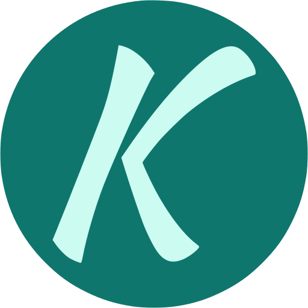

  

<h1 align="center">Kiusan</h1>

  𐌺𐌹𐌿𐍃𐌰𐌽, <em>kiusan</em>, Gothic for "to choose"

Kiusan is a small, self-hosted web app for scheduling meetings and voting
on stuff.

## What Kiusan does

- **Meeting polls** with dates and optional times. Optional restrictions: Respondents can only choose one date and time, good for scheduling one-on-one meetings; respondents can't see other respondents' choices.
- **Voting polls** with text or image options. There are different voting types (yes/no, yes/maybe/no, free text) and the optional restrictions from meeting polls are also available.
- **Two random links per poll**: a respondent link and an organizer link to manage the poll.
- **Answer management**: respondents can edit and delete their own answers while the poll is open. On the organizer page, there are functions to edit and delete answers, edit, close, re-open and delete the poll.

## What Kiusan doesn't provide

- **No logins, no accounts.** Respondents are identified by a per-poll browser cookie. As long as they don't delete their cookies, they can edit their own answer.
- **Minimal data.** No telemetry, no tracking, no analytics. Only the data you enter is saved. When a poll is deleted, all data associated with it is purged from the database.

## How it works

Create a poll, get two random URLs. Share the respondent link and keep the admin link for yourself. There is no sign-up, neither for you nor the respondents. Make sure to keep the admin link to yourself. **Anyone** with it can edit, close or delete your poll.

## Tech stack

Kiusan is written in Go with the [Fiber v3](https://gofiber.io) web framework. You can choose your storage backend. Currently, it supports SQLite for small deployments, or MySQL/MariaDB, or PostgreSQL for heavier use. Pages are server-side rendered templates with a sprinkle of vanilla JavaScript (no frameworks), self-hosted fonts, and built-in localization (currently English + German). The whole app ships as one
static binary and can be configured by environment variables or a config file.

## Getting started

See [INSTALLATION.md](INSTALLATION.md).

## Note on AI use

This project was initially started before the advent of AI models capable of programming to learn Go and web programming and to build myself an alternative to Doodle and the like. All the JavaScript, CSS and HTML templates quickly became too tedious for me, so I abandoned it. With the release of capable open-weight AI models I thought I'd test their limits on a local rig. This project was almost entirely written by AI, specifically Qwen 3.8 27B, under human guidance and review.

## License

Kiusan is licensed under the [MIT License](LICENSE).
